# ADR 0006: Android Compose Item-Driven UI (`ItemTree` / `ItemScreen` / `ItemUiState` / `ItemRenderer`) Architecture

## Status
**Accepted (Updated)**

## Context
As setting interfaces expand to multi-depth hierarchies (e.g., `Settings -> Bluetooth -> Advanced` or `Settings -> Bluetooth -> DeviceDetail/{deviceId}`), conventional UI definitions encounter several friction points:
1. **Recomposition Inefficiencies**: Mutable tree models or embedding lambdas inside `UiState` cause Compose compiler skip failures and redundant `StateFlow` emissions.
2. **Key Collision, Manual String Routes & `<clinit>` Cycles**: Hardcoded route strings are error-prone, while nested `object` screens referencing each other cause JVM static initialization (`<clinit>`) deadlocks/null references.
3. **Static vs Dynamic Argument SubScreens**: Some subscreens reuse the same layout with compile-time static parameters (e.g., Driver vs Passenger seat), while others require runtime navigation arguments (e.g., `{deviceId}`).
4. **Centralized Custom Item Rendering Bottleneck**: When `NavHost` automatically registers all screens from a root tree, passing a `when (customItem)` lambda to `DrawTree` forces the top-level host to know about every custom component across all subscreens.
5. **Static Metadata vs Dynamic State Separation**: `UiItem` nodes represent static tree structure, whereas runtime UI requires reactive `value`, `isVisible`, and `isEnabled` state streams.

---

## Decisions

### 1. `class` SubScreen Hierarchy via `by subScreen(...)` Delegation
- **Root as `object`, SubScreens as `class`**: Only the root screen (`SettingItems`) is declared as an `object`. All child subscreens (`BluetoothScreen`, `AdvancedScreen`, `WifiScreen`, `SeatDetailScreen`, `DeviceDetailScreen`) are `class` definitions instantiated via `by subScreen(...)` property delegation on their parent screen.
- **Singleton Caching & Auto-Registration**: `by subScreen` instantiates the child screen once, caches the instance, passes the property name as the screen identifier (`route = "${parent.route}/$name"`), and automatically registers it in `parent.subScreens`.
- **Zero Circular References on `target` Declaration**: Because `val Bluetooth by subScreen(::BluetoothScreen)` is already initialized before `val bluetoothEntry by subScreenEntry(target = Bluetooth)`, entries can declare their static `target` screen directly with zero `<clinit>` circular reference risk.
- **Static & Dynamic Arguments**:
  - **Static Argument SubScreens**: Reuse a single screen class with different constructor parameters:
    ```kotlin
    val DriverSeat by subScreen { parent, name -> SeatDetailScreen(parent, name, SeatPosition.DRIVER) }
    val PassengerSeat by subScreen { parent, name -> SeatDetailScreen(parent, name, SeatPosition.PASSENGER) }
    ```
  - **Dynamic Argument SubScreens**: Declare `routeArg = "deviceId"` on `ItemScreen` to generate `routePattern = "SettingItems/Bluetooth/DeviceDetail/{deviceId}"` and build runtime routes via `DeviceDetail.createRoute("Galaxy_Buds3_Pro")`.

### 2. Full Multi-Level Breadcrumbs (`Screen > Section > Screen > Section > Item`)
- **Route Excludes Section, Breadcrumb Includes All Levels**: Screen routes remain concise (`SettingItems/Bluetooth/Advanced`), while `screen.screenBreadcrumb` automatically inspects `parent.tree` to find the enclosing `UiSectionItem` that holds the `UiSubScreenEntryItem` targeting the child screen.
- Together with `ItemSearchIndexer`, this produces complete multi-depth breadcrumbs across arbitrary nesting levels (e.g., `환경 설정 > 주요 설정 > 블루투스 설정 > 기본 연결 > 블루투스 고급 설정 > 오디오 고급 설정 > 듀얼 오디오`).

### 3. Automatic `NavHost` Registration & Dual Anchor Routes (`?anchor={key}` & `route/{key}`)
- `rootScreen.allScreens()` recursively collects all descendant screens so `NavHost` registers every screen automatically in a single loop.
- Each screen supports two anchor route formats simultaneously for DeepLink scrolling (`BringIntoViewRequester`) and visual highlighting:
  1. **Query Anchor (`anchorRoutePattern = "$routePattern?anchor={anchor}"`)**: Handles both normal screen entry (`anchor = null`) and query-based item/section anchoring (`SettingItems/Bluetooth?anchor=masterToggle` or `?anchor=connectionSection`).
  2. **Path Anchor (`pathAnchorRoutePattern = "$routePattern/{anchor}"`)**: Supports legacy direct key navigation (`SettingItems/Bluetooth/masterToggle`, matching `item.key` / `section.key` directly).
- **CompositionLocal Strategy**:
  - `LocalItemNavigator`, `LocalItemControllerRegistry`, and `LocalItemRendererRegistry` use `staticCompositionLocalOf` (values do not change across the host lifecycle, avoiding read-tracking overhead).
  - `LocalHighlightKey` uses `compositionLocalOf` (when highlight state changes or is cleared, only the highlighted item recomposes).

### 4. Pure `@Immutable` `ItemUiState` & `StatefulItemController`
- **`UiItem` (Static Metadata) vs `ItemUiState` (Dynamic State)**:
  - `UiItem` holds static tree metadata (`key`, default `title`, `targetScreen`).
  - `ItemController` emits `val uiState: StateFlow<ItemUiState>` (`SectionUiState`, `LinearUiState`, `ToggleUiState`, `TextUiState`, `EntryUiState`, or custom states like `AudioLatencyUiState`) encapsulating runtime `value`, `isVisible`, and `isEnabled`.
- **Pure Data `UiState` + Separate `controller::onValueChanged` Lambda**:
  - `ItemUiState` data classes never embed event lambdas, keeping `equals()`, `hashCode()`, `toString()`, `StateFlow` deduplication, and unit testing (`assertEquals`) 100% pure.
  - User interactions are passed separately as `controller::onValueChanged` to the renderer.
- **Unified `ToggleItemController` & `EntryItemController`**:
  - `ToggleItemController` extends `StatefulItemController<ToggleUiState, Boolean>()`.
  - `EntryItemController` extends `StatefulItemController<EntryUiState, ItemNavigator>()`. Its `onValueChange(navigator)` invokes `onClick(navigator)`, which defaults to navigating to `item.targetScreen` and can be overridden for dynamic routes (e.g., `navigator(DeviceDetail.createRoute("Galaxy_Buds3_Pro"))`). `SubScreenEntry` requires no special-case handling in `DrawTree`.

### 5. Unified `ItemRenderer<S : ItemUiState, V>` & `ItemRendererRegistry` (Aggregated by `UiState`)
- Both built-in Common Items and feature-specific Custom Items implement `ItemRenderer<S : ItemUiState, V>(stateClass: KClass<S>)` and are aggregated in `ItemRendererRegistry` by **`ItemUiState` class (`KClass<out ItemUiState>`)**.
- Custom renderers (e.g., `AudioLatencyVisualizerRenderer : ItemRenderer<AudioLatencyUiState, Int>`) are bound via Hilt `@Binds @IntoSet` just like `ItemController`s.
- **`DrawTree` Central Pipeline**:
  1. Looks up `controller` and collects `uiState` via `collectAsStateWithLifecycle()` (or synthesizes a default `ItemUiState` for static controller-less nodes).
  2. Checks **`if (!uiState.isVisible) return@key`** centrally to control visibility for all sections and items.
  3. Applies `BringIntoViewRequester` when `LocalHighlightKey.current == item.key`.
  4. Resolves `renderer = rendererRegistry.getOrNull(uiState)` by `uiState::class` and calls `renderer.Render(state = uiState, onValueChanged = controller::onValueChanged, ...)`.

```mermaid
flowchart TD
    subgraph Declaration["1. Static Tree & Screen Hierarchy (SettingItems)"]
        Root["SettingItems (object)<br/>route: 'SettingItems'"]
        BT["BluetoothScreen (class via by subScreen)<br/>route: 'SettingItems/Bluetooth'"]
        Dev["DeviceDetailScreen (routeArg = 'deviceId')<br/>routePattern: 'SettingItems/Bluetooth/DeviceDetail/{deviceId}'"]
        Seat["SeatDetailScreen (Static Arg: DRIVER / PASSENGER)<br/>routes: 'SettingItems/DriverSeat', 'SettingItems/PassengerSeat'"]
        Root --> BT --> Dev
        Root --> Seat
    end

    subgraph StateManagement["2. ItemController & Pure ItemUiState (Hilt @IntoSet)"]
        CtrlReg["ItemControllerRegistry<br/>Map&lt;String, ItemController&gt;"]
        ToggleCtrl["ToggleItemController<br/>uiState: StateFlow&lt;ToggleUiState&gt;<br/>onValueChange(Boolean)"]
        EntryCtrl["EntryItemController<br/>uiState: StateFlow&lt;EntryUiState&gt;<br/>onValueChange(ItemNavigator)"]
        CustomCtrl["AudioLatencyVisualizerController<br/>uiState: StateFlow&lt;AudioLatencyUiState&gt;<br/>onValueChange(Int)"]
        CtrlReg --> ToggleCtrl
        CtrlReg --> EntryCtrl
        CtrlReg --> CustomCtrl
    end

    subgraph Rendering["3. DrawTree & UiState-Based ItemRendererRegistry"]
        Draw["DrawTree(screen.tree)"]
        DrawItem["DrawItem(item)<br/>1. Collect controller.uiState<br/>2. if (!uiState.isVisible) return<br/>3. Anchor & Highlight (LocalHighlightKey)"]
        RenderReg["ItemRendererRegistry<br/>Map&lt;KClass&lt;out ItemUiState&gt;, ItemRenderer&gt;"]
        BuiltIn["Built-in Renderers<br/>(Section / Linear / Toggle / Text / Entry)"]
        CustomRend["Custom Renderers (@IntoSet)<br/>(AudioLatencyVisualizerRenderer)"]
        Draw --> DrawItem
        DrawItem -->|lookup by uiState::class| RenderReg
        DrawItem -->|pass state + controller::onValueChanged| BuiltIn
        DrawItem -->|pass state + controller::onValueChanged| CustomRend
        RenderReg --> BuiltIn
        RenderReg --> CustomRend
    end
```



### 6. ProGuard / R8 Safety
Explicit ProGuard keep rule ensures obfuscation does not alter `ItemScreen` class names when `explicitName` is omitted:
```proguard
-keepnames class * extends com.example.uifw.item.ItemScreen
```
