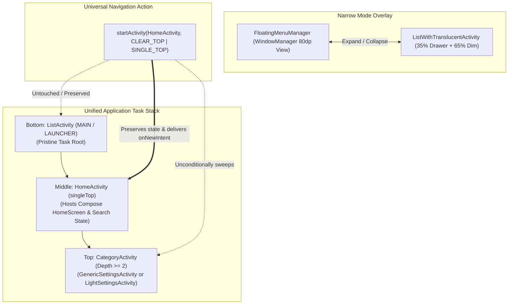

# ADR 0007: Floating Window Overlay, ListActivity Task Root, and Unified CLEAR_TOP Navigation

## Status
**Accepted**

## Context
In ADR 0006, we eliminated `CategoryHostActivity` by tracking `IBinder` TaskFragment tokens via Jetpack WindowManager's `splitInfoList()` and dismissing category stacks via `ActivityEmbeddingController.finishActivityStacks()`.

However, as production requirements evolved across diverse screen form-factors and Android OS versions, two major architectural bottlenecks persisted:

### 1. Inherent Limitations of Pinned TaskFragment Overlays in Narrow Mode
In Narrow (Overlay) Mode, [ListOverlayActivity.kt](file:///c:/Users/user/Documents/antigravity/kind-curie/app/src/main/java/com/example/lifecycleapp/ListOverlayActivity.kt) was embedded as a pinned overlay TaskFragment (`setOverlayCreateParams`):
- **High Platform Requirement**: Pinned overlays require **WindowManager Extension Version >= 8**, causing fatal or unsupported behavior on older OS versions or vendor builds.
- **Touch Interception / Window Sizing Overhead**: Even when transparent, an Activity window intercepts touches across its entire bounding rectangle. Consequently, [OverlayBoundsHelper.kt](file:///c:/Users/user/Documents/antigravity/kind-curie/app/src/main/java/com/example/lifecycleapp/OverlayBoundsHelper.kt) had to dynamically resize the physical window bounds between `80dp × 80dp` and `100% × 100%` on every collapse/expand.
- **Focus Routing Workarounds**: Returning hardware Back key focus to underlying activities required accessing internal `SplitController.mPresenter` reflection or artificial `FLAG_NOT_FOCUSABLE` toggling.

### 2. Task Stack Inversion when HomeActivity was Task Root
Previously, [HomeActivity.kt](file:///c:/Users/user/Documents/antigravity/kind-curie/feature-home/src/main/java/com/example/feature/home/HomeActivity.kt) was the `MAIN`/`LAUNCHER` Task Root:
- In **Wide Mode**, launching [ListActivity.kt](file:///c:/Users/user/Documents/antigravity/kind-curie/app/src/main/java/com/example/lifecycleapp/ListActivity.kt) as a left 35% sidebar required stacking `ListActivity` **above** `HomeActivity` in the task stack using an artificial 2-step RTL SplitPairRule (`Home RTL 65:35 List` + `List LTR 35:65 Category`).
- Because `ListActivity` was higher in the stack than `HomeActivity`, calling `startActivity(HomeActivity, CLEAR_TOP)` destroyed `ListActivity` along with the category screens, making `CLEAR_TOP` impossible in Wide Mode.
- Consequently, Wide Mode had to rely on `finishActivityStacks()` and `CategoryStackManager`, diverging from the clean `CLEAR_TOP` navigation used in Narrow Mode.

---

## Technical Discovery & Core Breakthrough

### 1. Floating Window (`WindowManager`) Decoupled Overlay
Instead of running a heavy pinned Activity/TaskFragment 24/7 as an overlay:
- **Collapsed State**: [FloatingMenuManager.kt](file:///c:/Users/user/Documents/antigravity/kind-curie/app/src/main/java/com/example/lifecycleapp/FloatingMenuManager.kt) attaches an 80dp circular floating button directly to the system `WindowManager` (`TYPE_APPLICATION` / `TYPE_APPLICATION_PANEL`).
  - Outside the 80dp circle, no window exists—touch events pass 100% cleanly to underlying views without any window bound resizing.
- **Expanded State**: Clicking the button temporarily detaches the floating view and launches [ListWithTranslucentActivity.kt](file:///c:/Users/user/Documents/antigravity/kind-curie/app/src/main/java/com/example/lifecycleapp/ListWithTranslucentActivity.kt), a standard translucent Activity with a 35% left drawer and 65% modal dim scrim.
  - Tapping the dim scrim or pressing Back simply finishes this single-instance activity. Its lifecycle is identical to any standard Android Activity.

### 2. Setting ListActivity as Pristine Task Root
By setting [ListActivity.kt](file:///c:/Users/user/Documents/antigravity/kind-curie/app/src/main/java/com/example/lifecycleapp/ListActivity.kt) as the application's true Task Root (`MAIN`/`LAUNCHER`):
- The Activity Stack becomes naturally ordered:
  ```text
  [Top]    CategoryActivity (GenericSettingsActivity / LightSettingsActivity, Depth >= 2)
  [Middle] HomeActivity (SingleTop / Search Query & Scroll State preserved)
  [Bottom] ListActivity (Pristine Task Root / LaunchMode: singleTop)
  ```
- **Wide Mode**: `ListActivity` (35%) pairs with `HomeActivity` or `CategoryActivity` (65%) via a single, standard LTR `SplitPairRule`.
- **Narrow Mode**: `ListActivity` rests at the very bottom of the stack (STOPPED), while `HomeActivity` expands full screen.
- **Fold/Unfold (Transition)**: Because `ListActivity` is never destroyed, expanding from Fold to Wide simply re-enables the `SplitPairRule`. WindowManager pairs the bottom `ListActivity` with the top screen seamlessly without activity recreation or state loss.

### 3. Unified CLEAR_TOP | SINGLE_TOP Across All Form Factors
With `HomeActivity` positioned strictly in the middle of the stack:
- Calling `startActivity(HomeActivity, CLEAR_TOP | SINGLE_TOP)`:
  - Destroys all activities *above* `HomeActivity` (the entire category stack and deep sub-screens).
  - Delivers `onNewIntent` to `HomeActivity`, preserving search queries and Compose scroll state.
  - Leaves activities *below* `HomeActivity` (`ListActivity`) completely intact and alive.
- This mechanism functions **identically in both Wide and Narrow modes**, eliminating all need for `CategoryStackManager`, IBinder token extraction, or `finishActivityStacks`.

---

## Decisions



1. **Adopt `FloatingMenuManager` + `ListWithTranslucentActivity` for Narrow Mode**:
   - Replaced `ListOverlayActivity` and removed all dependencies on WindowManager Extension Version 8 pinned overlays and `OverlayBoundsHelper` reflection.
2. **Promote `ListActivity` to Pristine Task Root**:
   - Marked `ListActivity` as `exported="true"` with `ACTION_MAIN` / `CATEGORY_LAUNCHER` in [app/src/main/AndroidManifest.xml](file:///c:/Users/user/Documents/antigravity/kind-curie/app/src/main/AndroidManifest.xml).
   - Removed `MAIN`/`LAUNCHER` filters from [feature-home/src/main/AndroidManifest.xml](file:///c:/Users/user/Documents/antigravity/kind-curie/feature-home/src/main/AndroidManifest.xml).
3. **Unify `CLEAR_TOP` Navigation**:
   - Both Wide Mode and Narrow Mode navigate back to Home or switch categories by launching `HomeActivity` with `FLAG_ACTIVITY_CLEAR_TOP | FLAG_ACTIVITY_SINGLE_TOP`.
   - Bypassed `CategoryStackManager` and WindowManager `finishActivityStacks()` entirely.
4. **Guaranteed Clean App Termination**:
   - When the user presses Back on `HomeActivity`, `HomeActivity` calls `finishAffinity()`, guaranteeing that `ListActivity` at the root and all active floating views are cleanly destroyed together.

---

## Consequences

### Positive
- **Architectural Symmetry**: Wide and Narrow modes share identical stack cleanup and category launching logic (`CLEAR_TOP`).
- **Complete Elimination of Experimental / Reflection Code**: Removed `setOverlayCreateParams`, `TaskFragmentOrganizer` token reflection, and complex WMS window boundary synchronization.
- **Enhanced OS Compatibility**: Works out of the box on all standard Android versions without requiring WindowManager Extension Version 8.
- **Seamless Fold/Unfold State Preservation**: In Narrow mode, `ListActivity` remains paused at the task root. When unfolding into Wide mode, it instantly pairs with the running content activity without reloading or flicker.
- **100% Test Pass Rate**: Verified against comprehensive UI Automator suites (`scenario1`, `scenario4`, `scenario10`, `scenario11`, `scenario12`, `scenario13`).

### Negative / Trade-offs
- **Dormant Root Activity in Narrow Mode**: In Narrow mode, `ListActivity` stays alive in `onStop()` beneath `HomeActivity`. However, memory footprint is minimal and clean task termination is ensured via `finishAffinity()` and `appExitListener`.
