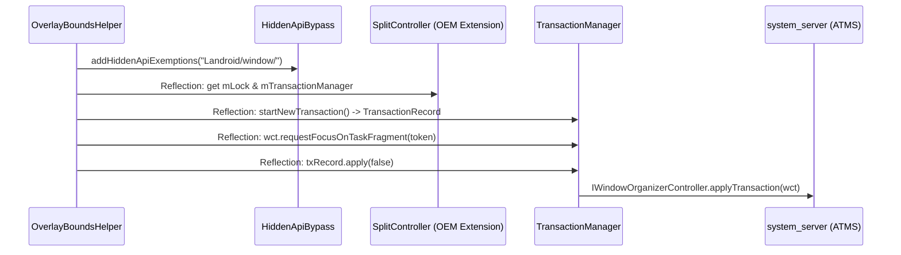
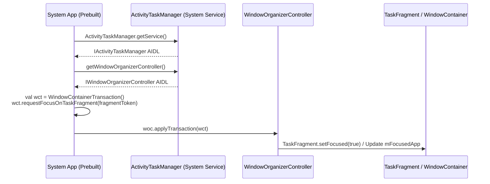
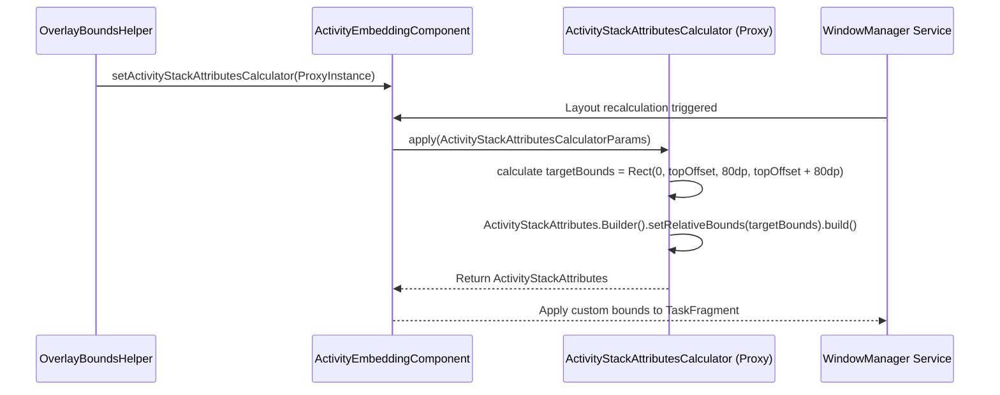

# WindowManager 포커스 제어 및 오버레이 바운즈 설정 가이드 (Reflection vs System API)

본 문서는 **1) Home/콘텐츠 화면으로의 포커스 제어**와 **2) 오버레이 윈도우의 바운즈 위치를 "왼쪽 가운데"에서 "왼쪽 위"로 조정하는 메커니즘**에 대해, 서드파티 앱을 위한 **Reflection 방식**과 AOSP Prebuilt / System App을 위한 **System API (ATMS / WCT) 방식**을 상세히 비교·정리합니다.

---

## 1. 개요 및 핵심 요구사항

| 항목 | 목적 및 동작 | Jetpack WindowManager 공식 Public API의 한계 |
| :--- | :--- | :--- |
| **1. Focus 제어** | Back 키 입력을 사이드바(`PrimaryActivity`)나 접힌 오버레이(`PrimaryOverlayActivity`)가 가로채지 않고, **`HomeActivity` 또는 우측 콘텐츠 카테고리(`Seat`, `Light` 등)**가 수신하도록 윈도우 포커스(`mFocusedApp`, `mCurrentFocus`)를 전환 | Jetpack WindowManager의 Public API에는 ActivityStack 간 윈도우 포커스를 직접 강제 전환하는 메서드가 없음 |
| **2. Overlay Bounds 위치 제어** | 접힌 상태의 80dp 플로팅 메뉴 버튼을 화면 수직 중앙(Left-Center)이 아닌, **상태표시줄 바로 아래의 좌측 상단("왼쪽 위", Top-Left)** 코너에 정확히 배치 | Public `EmbeddingBounds`는 4가지 축 중앙 정렬(`ALIGN_LEFT`, `ALIGN_TOP`, `ALIGN_RIGHT`, `ALIGN_BOTTOM`)만 제공하며, `ALIGN_LEFT`는 수직 중앙에 배치됨 |

---

## 2. 포커스(Focus) 제어 상세 비교

### 1) 왜 포커스 제어가 필요한가?
- **Wide Mode**: 좌측 35% 사이드바(`PrimaryActivity`)를 터치하거나 포커스를 가졌을 때, 시스템 Back 키를 누르면 사이드바가 Back 이벤트를 소비하지 않고 우측의 `HomeActivity` 또는 카테고리 화면이 이벤트를 받아야 합니다.
- **Narrow Mode**: 상단에 핀으로 고정된 `PrimaryOverlayActivity`(80dp 버튼)가 화면 최상단에 상주하므로, 버튼이 접혀 있을 때 Back 키가 바닥에 깔린 `HomeActivity` 또는 카테고리 화면으로 직통 전달되어야 합니다. 서랍이 열렸을 때만 오버레이가 포커스를 가져와 서랍을 닫아야 합니다.

---

### 2) 방법 A: Reflection 방식 (일반 3rd Party App 환경)
일반 앱은 `android.permission.MANAGE_ACTIVITY_TASKS` 권한을 획득할 수 없고 `Landroid/window/` 비공개 클래스가 제한되므로, WindowManager Extension의 내부 구현체와 숨겨진 API를 리플렉션으로 우회 호출합니다.



#### 구현 상세 ([OverlayBoundsHelper.kt](file:///c:/Users/user/Documents/antigravity/kind-curie/app/src/main/java/com/example/lifecycleapp/OverlayBoundsHelper.kt)):
```kotlin
// 1. Hidden API Exemption 등록 (Landroid/window/)
HiddenApiBypass.addHiddenApiExemptions("Landroid/window/")

// 2. WindowExtensions -> SplitController 내부 인스턴스 조회
val splitController = WindowExtensionsProvider.getWindowExtensions()
    ?.activityEmbeddingComponent ?: return false

val lock = splitController.javaClass.getDeclaredField("mLock")
    .apply { isAccessible = true }.get(splitController)
val txManager = splitController.javaClass.getDeclaredField("mTransactionManager")
    .apply { isAccessible = true }.get(splitController)

synchronized(lock) {
    // 3. 트랜잭션 시작
    val startTxMethod = txManager.javaClass.getDeclaredMethod("startNewTransaction").apply { isAccessible = true }
    val txRecord = startTxMethod.invoke(txManager)

    // 4. WindowContainerTransaction.requestFocusOnTaskFragment 리플렉션 호출
    val getTxMethod = txRecord.javaClass.getDeclaredMethod("getTransaction").apply { isAccessible = true }
    val wct = getTxMethod.invoke(txRecord)
    val requestFocusMethod = Class.forName("android.window.WindowContainerTransaction")
        .getDeclaredMethod("requestFocusOnTaskFragment", IBinder::class.java).apply { isAccessible = true }
    requestFocusMethod.invoke(wct, targetFragmentToken)

    // 5. 트랜잭션 적용
    val applyMethod = txRecord.javaClass.getDeclaredMethod("apply", Boolean::class.javaPrimitiveType).apply { isAccessible = true }
    applyMethod.invoke(txRecord, false)
}
```

---

### 3) 방법 B: System API / ATMS 직접 호출 (Prebuilt / System App 환경)
AOSP 시스템 앱 또는 Privileged 권한(`android.permission.MANAGE_ACTIVITY_TASKS`)을 가진 환경에서는 **Reflection이 0%**이며, 안드로이드 프레임워크의 공식 IPC 인터페이스를 직접 호출합니다.



#### 구현 상세:
```kotlin
// AndroidManifest.xml:
// <uses-permission android:name="android.permission.MANAGE_ACTIVITY_TASKS" />

fun requestFocusViaAtm(fragmentToken: IBinder): Boolean {
    return try {
        // 1. ATMS 바인더 서비스 획득 (AIDL compile-time link)
        val atm = ActivityTaskManager.getService() ?: return false
        val woc = atm.windowOrganizerController ?: return false

        // 2. WindowContainerTransaction 직접 생성 및 포커스 요청 (System API)
        val wct = WindowContainerTransaction()
        wct.requestFocusOnTaskFragment(fragmentToken)

        // 3. ATMS로 직접 트랜잭션 전송 (0% Reflection)
        woc.applyTransaction(wct)
        true
    } catch (e: Exception) {
        Log.e("ATM Focus", "Failed to apply focus via ATMS: $e", e)
        false
    }
}
```

- **장점**:
  1. `mLock`, `mTransactionManager` 등 OEM Extension 내부 비공개 필드 접근 불필요.
  2. 안드로이드 OS 버전 업그레이드 시 내부 필드 변경으로 인한 크래시 위험 완전 차단.
  3. 다른 프로세스(예: 외부 플러그인 `LightSettingsActivity`)의 `TaskFragment`에도 동일하게 즉시 적용됨.

---

## 3. Overlay Bounds ("왼쪽 위" 배치) 제어 상세 비교

### 1) 왜 "왼쪽 가운데"에서 "왼쪽 위"로 변경해야 하는가?
- Jetpack WindowManager의 `EmbeddingBounds.Alignment.ALIGN_LEFT`는 수평으로는 좌측에 붙지만, **수직으로는 화면 높이의 50% 지점(가운데)에 배치**됩니다.
- 그러나 차량용 UI 및 일반 앱 네비게이션 가이드라인에서 메뉴 플로팅 버튼은 **상태표시줄(Status Bar) 바로 아래 좌측 상단("왼쪽 위", `Rect(0, topOffset, 80dp, topOffset + 80dp)`)**에 위치해야 합니다.

---

### 2) 방법 A: Reflection / Dynamic Proxy 방식 (WindowManager Extension 활용)
Jetpack WindowManager의 상위 API에는 커스텀 절대 좌표가 없지만, OEM Extension 계층(`androidx.window.extensions.embedding`)에는 `ActivityStackAttributesCalculator`와 `setRelativeBounds(Rect)`가 존재합니다. 일반 앱에서는 이 OEM Extension을 Reflection과 Dynamic Proxy로 후킹합니다.



#### 구현 상세 ([OverlayBoundsHelper.kt](file:///c:/Users/user/Documents/antigravity/kind-curie/app/src/main/java/com/example/lifecycleapp/OverlayBoundsHelper.kt)):
```kotlin
// 1. ActivityStackAttributesCalculator 프록시 등록
val providerClass = Class.forName("androidx.window.extensions.WindowExtensionsProvider")
val getExtensions = providerClass.getDeclaredMethod("getWindowExtensions").invoke(null)
val embeddingComponent = getExtensions.javaClass.getMethod("getActivityEmbeddingComponent").invoke(getExtensions)

val functionClass = Class.forName("androidx.window.extensions.core.util.function.Function")
val proxy = Proxy.newProxyInstance(functionClass.classLoader, arrayOf(functionClass)) { _, method, args ->
    if (method.name == "apply" && args != null && args.isNotEmpty()) {
        val params = args[0]
        val parentInfo = params.javaClass.getMethod("getParentContainerInfo").invoke(params)
        val windowMetrics = parentInfo.javaClass.getMethod("getWindowMetrics").invoke(parentInfo)
        val taskBounds = windowMetrics.javaClass.getMethod("getBounds").invoke(windowMetrics) as Rect

        val density = context.resources.displayMetrics.density
        val buttonSizePx = (80 * density).toInt()
        val topOffset = getStatusBarHeight(context)

        // 핵심: 왼쪽 가운데가 아닌 상태표시줄 바로 아래 "왼쪽 위" 사각형 계산
        val targetBounds = if (isOverlayDrawerExpanded) {
            Rect(0, 0, (taskBounds.width() * 0.35).toInt(), taskBounds.height())
        } else {
            Rect(0, topOffset, buttonSizePx, topOffset + buttonSizePx)
        }

        val builderClass = Class.forName("androidx.window.extensions.embedding.ActivityStackAttributes\$Builder")
        val builder = builderClass.getDeclaredConstructor().newInstance()
        builderClass.getMethod("setRelativeBounds", Rect::class.java).invoke(builder, targetBounds)
        return@newProxyInstance builderClass.getMethod("build").invoke(builder)
    }
    null
}

embeddingComponent.javaClass.getMethod("setActivityStackAttributesCalculator", functionClass)
    .invoke(embeddingComponent, proxy)
```

---

### 3) 방법 B: System API / ATMS 직접 조작 (Prebuilt / System App 환경)

AOSP System App / Prebuilt 환경에서는 두 가지 방법으로 구현할 수 있습니다.

#### Option B-1. ATMS WindowContainerTransaction (`setBounds` / `setRelativeBounds`) 직접 호출
AOSP `android.window.WindowContainerTransaction`과 `TaskFragment.java`는 TaskFragment의 사각형 영역을 변경하는 System API를 제공합니다.

```kotlin
// android.permission.MANAGE_ACTIVITY_TASKS 권한 보유 환경
fun updateOverlayBoundsViaAtm(
    overlayFragmentToken: IBinder,
    targetBounds: Rect
): Boolean {
    return try {
        val atm = ActivityTaskManager.getService() ?: return false
        val woc = atm.windowOrganizerController ?: return false

        val wct = WindowContainerTransaction()
        // TaskFragment의 상대/절대 바운즈 직접 지정
        wct.setBounds(overlayFragmentToken, targetBounds)
        // 또는 relative bounds (Android 14+):
        // wct.setRelativeBounds(overlayFragmentToken, targetBounds)

        woc.applyTransaction(wct)
        true
    } catch (e: Exception) {
        Log.e("ATM Bounds", "Failed to set bounds via ATMS: $e", e)
        false
    }
}
```
- **동작 원리**:
  - `system_server`의 `TaskFragment.java`는 WCT의 `setBounds` 처리를 수신하면, TaskFragment 내부 `WindowContainer`의 bounds를 직접 `targetBounds`(`Rect(0, topOffset, 80dp, topOffset + 80dp)`)로 갱신하고 디스플레이 계층과 SurfaceFlinger에 전달합니다.
  - 별도의 WindowManager Extension 콜백 없이도 OS 레벨에서 직접 윈도우 크기와 위치를 강제할 수 있습니다.

#### Option B-2. AOSP 플랫폼 소스 빌드 (OEM WindowManager Extension 컴파일-타임 직접 링크)
AOSP 플랫폼 트리(`vendor/` 또는 `frameworks/base/`)에서 빌드되는 System App의 경우, `androidx.window.extensions.jar`를 compile-time 라이브러리로 직접 링크할 수 있습니다 (`LOCAL_STATIC_JAVA_LIBRARIES` 또는 `libs = ["androidx.window.extensions"]`).

```kotlin
// 컴파일 타임에 타입이 직접 보장되는 System App 코드 (Reflection 0%)
import androidx.window.extensions.WindowExtensionsProvider
import androidx.window.extensions.embedding.ActivityStackAttributes
import androidx.window.extensions.embedding.ActivityStackAttributesCalculatorParams

val embeddingComponent = WindowExtensionsProvider.getWindowExtensions().activityEmbeddingComponent

embeddingComponent.setActivityStackAttributesCalculator { params: ActivityStackAttributesCalculatorParams ->
    val taskBounds = params.parentContainerInfo.windowMetrics.bounds
    val density = context.resources.displayMetrics.density
    val buttonSizePx = (80 * density).toInt()
    val topOffset = getStatusBarHeight(context)

    val targetBounds = if (isDrawerExpanded) {
        Rect(0, 0, (taskBounds.width() * 0.35f).toInt(), taskBounds.height())
    } else {
        Rect(0, topOffset, buttonSizePx, topOffset + buttonSizePx)
    }

    ActivityStackAttributes.Builder()
        .setRelativeBounds(targetBounds)
        .build()
}
```
- **장점**: Dynamic Proxy나 `Class.forName` 없이 순수 Java/Kotlin 문법으로 완전한 정적 타입 검증 및 프로가드/R8 최적화 적용 가능.

---

## 4. 종합 요약 및 비교표

| 항목 | 일반 서드파티 앱 (현재 코드베이스 지원 방식) | AOSP Prebuilt / System App (권장 방식) |
| :--- | :--- | :--- |
| **필요 권한** | 일반 앱 권한 (`HiddenApiBypass` 필요) | `android.permission.MANAGE_ACTIVITY_TASKS` (시스템/서명 권한) |
| **포커스 제어 방식** | `SplitController.mTransactionManager` Reflection 후 `wct.requestFocusOnTaskFragment()` 간접 호출 | `ActivityTaskManager.getService().windowOrganizerController.applyTransaction(wct)` 직접 호출 (Reflection 0%) |
| **오버레이 바운즈 제어 ("왼쪽 위")** | `ActivityStackAttributesCalculator` Dynamic Proxy + `setRelativeBounds(Rect)` Reflection | **1)** WCT `setBounds(token, Rect)` 직접 호출, 또는<br/>**2)** `androidx.window.extensions` compile-time static link로 Calculator 타입세이프 호출 |
| **외부 프로세스 호환성** | `ActivityStack` 내 `IBinder` 토큰이 유효하여 정상 작동 | AOSP `system_server`가 직접 바인더 토큰을 식별하므로 프로세스 경계와 무관하게 100% 안정 작동 |
| **유지보수성 & 안정성** | OS 마이너 업데이트 시 내부 필드명 변경 리스크 상존 | 안드로이드 공식 System API / AIDL 규격을 준수하므로 장기적 안정성 보장 |
