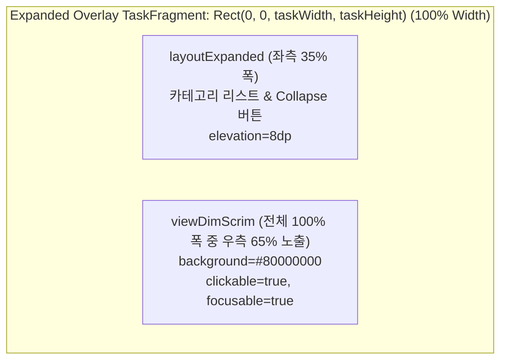

# WindowManager 포커스 제어, 오버레이 바운즈, Dim Scrim 아키텍처 및 실험 결과

본 문서는 Android 16 (API 36/37) 에뮬레이터의 `services.jar` 및 `androidx.window.extensions.jar` 바이트코드 역컴파일 분석과 실제 기기/에뮬레이터 계측 테스트(Instrumented UI Test) 결과를 바탕으로 다음 세 가지 핵심 주제를 정리합니다.

1. **포커스(Focus) 이동 제어**: `ATMS (0-Reflection)` vs `No-ATMS (1-Reflection, TaskFragmentOrganizer)` 비교 및 멀티윈도우 환경에서 `FLAG_NOT_FOCUSABLE` 사용 시의 문제점 분석
2. **오버레이 바운즈(Overlay Bounds) 제어**: 좌측 상단(`80dp × 80dp`) 배치 및 전체 폭(`100%`) 확장 (ATMS 불필요, Reflection 0회)
3. **Dim 처리 실험 결과**: 자체 Full-Width `viewDimScrim` 방식 vs 표준 `androidx.window` / WindowManager Dim (`DIM_AREA_ON_TASK` + `FLAG_DIM_BEHIND`) 실패 검증 결과

---

## 1. 포커스(Focus) 이동: `ATMS (0-Reflection)` vs `No-ATMS (1-Reflection)`

### 1.1 왜 윈도우 포커스 이동(`requestFocusOnTaskFragment`)이 필요한가?
- **Wide Mode**: 좌측 35% 메뉴(`ListActivity`)를 터치한 뒤 하드웨어/시스템 Back 키를 누를 때, 좌측 메뉴가 아닌 우측 65% 콘텐츠 영역(`HomeActivity` 또는 `CategoryHostActivity` 하위 스택, 외부 플러그인 `LightSettingsActivity` 포함)이 Back 키를 수신해야 합니다.
- **Narrow Mode**: 최상단에 핀(Pinned) 고정된 `ListOverlayActivity`가 접혀 있을 때(`80dp × 80dp`), Back 키가 하위 콘텐츠 컨테이너로 전달되어야 하며, 반대로 서랍이 펼쳐졌을 때는 오버레이가 포커스를 가져와 Back 키 입력 시 서랍을 먼저 닫아야 합니다.

---

### 1.2 `services.jar` 내부 두 가지 `applyTransaction` 경로와 권한 검증 차이

Android 프레임워크(`services.jar` 내 `com.android.server.wm.WindowOrganizerController`)에는 `WindowContainerTransaction`(이하 `WCT`)을 적용하는 **두 개의 서로 다른 Binder 진입점**이 존재합니다.

| 구분 | 경로 1: `IWindowOrganizerController.applyTransaction` (ATMS 직접 호출) | 경로 2: `ITaskFragmentOrganizerController.applyTransaction` (No-ATMS, Organizer 경유) |
| :--- | :--- | :--- |
| **호출 API** | `ActivityTaskManager.getService().windowOrganizerController.applyTransaction(wct)` | `TaskFragmentOrganizer.applyTransaction(wct, TASK_FRAGMENT_TRANSIT_CHANGE, false)` |
| **Server 검증 메서드** | `enforceTaskPermission("applyTransaction()")` | `validateAndGetOrganizer(caller)` (`enforceTaskFragmentOrganized`) |
| **필요 권한** | **`android.permission.MANAGE_ACTIVITY_TASKS`** (Signature/Privileged 권한 필수) | **권한 불필요 (0 Permission)** — 호출 프로세스 UID가 해당 `TaskFragment`를 생성한 `TaskFragmentOrganizer`의 UID와 일치하는지만 검사 |
| **Reflection 횟수** | **0회** (`framework-stubs` 컴파일 타임 직접 링크) | **최초 1회** (`SplitController.mPresenter` 필드 1회 조회 후 캐싱) |
| **`SplitController` 충돌 위험** | **0%** (`mLock`, `mTransactionManager` 미접근) | **0%** (`mLock`, `mTransactionManager` 미접근, `SplitPresenter`의 부모 클래스 메서드만 호출) |

#### 바이트코드 검증 (`services.jar` -> `WindowOrganizerController.java`)
1. **경로 2 (`ITaskFragmentOrganizerController.applyTransaction`)의 보안 검사**:
   - `WindowOrganizerController.applyTransaction(wct, transit, shouldApplyIndependently, remoteTransition)`는 `MANAGE_ACTIVITY_TASKS` 권한을 검사하지 않고, `wct.getTaskFragmentOrganizer()`가 등록된 Organizer인지 및 호출자의 Binder UID가 해당 Organizer의 UID와 동일한지(`validateAndGetOrganizer`)만 확인합니다.
   - `SplitController`의 내부 `mPresenter`(`SplitPresenter`)는 `android.window.TaskFragmentOrganizer`를 상속하며 현재 앱 프로세스 내에서 등록된 Organizer이므로, `presenter.applyTransaction(...)`을 호출하면 `wct.setTaskFragmentOrganizer(mInterface)`가 자동 세팅되어 **일반 앱 권한(No-ATMS)으로도 `system_server` 검증을 100% 통과**합니다.
2. **`SplitController`와의 상태/락 충돌 확률 = 0% 증명**:
   - `WindowOrganizerController.applyTaskFragmentOperation()`에서 `OP_TYPE_REQUEST_FOCUS_ON_TASK_FRAGMENT` (`opType = 12`)는 `TaskFragment` 내의 최상단 실행 중인 `ActivityRecord`를 찾아 `mRootWindowContainer.resumeFocusedTasksTopActivities()`로 WM 내부 포커스(`mFocusedApp`)만 갱신합니다.
   - 이 과정에서 `TaskFragmentOrganizer`(`SplitController`) 쪽으로 `onTransactionReady`나 `onTaskFragmentInfoChanged` 같은 **역방향 콜백을 전혀 발생시키지 않으며**, `SplitController.mLock`, `mTransactionManager`, `mTaskContainers`를 전혀 건드리지 않으므로 데드락이나 상태 불일치 확률이 **0%**입니다.

---

### 1.3 코드 비교: `ATMS (0-Reflection)` vs `No-ATMS (1-Reflection)`

#### 공통: `ActivityStack`에서 `IBinder` 토큰 추출 (0-Reflection)
`androidx.window.extensions.embedding.ActivityStack.Token`은 `toBundle()`을 공개 제공하며, 내부 키 `"androidx.window.extensions.embedding.ActivityStack.Token"`으로 `IBinder`를 꺼낼 수 있어 **두 방식 모두 토큰 추출에 리플렉션이 전혀 필요 없습니다(0-Reflection).**

```kotlin
// CategoryStackManager.kt / OverlayBoundsHelper.kt (0-Reflection 토큰 추출)
val binderToken: IBinder? = WindowExtensionsProvider.getWindowExtensions()
    ?.activityEmbeddingComponent
    ?.getActivityStackToken(tag)
    ?.toBundle()
    ?.getBinder("androidx.window.extensions.embedding.ActivityStack.Token")
```

#### 방식 1: `ATMS 0-Reflection` (`MANAGE_ACTIVITY_TASKS` 권한 보유 시스템 앱)
```kotlin
// AndroidManifest.xml: <uses-permission android:name="android.permission.MANAGE_ACTIVITY_TASKS" />
import android.app.ActivityTaskManager
import android.os.IBinder
import android.window.WindowContainerTransaction

fun requestFocusAtmsZeroReflection(fragmentToken: IBinder): Boolean {
    return try {
        val wct = WindowContainerTransaction()
        wct.requestFocusOnTaskFragment(fragmentToken)

        // IActivityTaskManager -> IWindowOrganizerController 직접 호출 (Reflection 0회)
        ActivityTaskManager.getService()
            .windowOrganizerController
            .applyTransaction(wct)
        true
    } catch (e: Throwable) {
        false
    }
}
```

#### 방식 2: `No-ATMS 1-Reflection` (현재 코드베이스 채택 — `MANAGE_ACTIVITY_TASKS` 불필요)
현재 [OverlayBoundsHelper.kt](file:///c:/Users/user/Documents/antigravity/kind-curie/app/src/main/java/com/example/lifecycleapp/OverlayBoundsHelper.kt#L145-L183)에 구현된 방식입니다. `SplitController.mPresenter`만 최초 1회 리플렉션으로 조회하여 `TaskFragmentOrganizer` 타입으로 캐싱한 뒤, 이후 모든 호출은 컴파일 타임 스텁([TaskFragmentOrganizer.java](file:///c:/Users/user/Documents/antigravity/kind-curie/framework-stubs/src/main/java/android/window/TaskFragmentOrganizer.java))을 통해 직접 호출합니다.

```kotlin
// OverlayBoundsHelper.kt (MANAGE_ACTIVITY_TASKS 권한 불필요, 최초 1회 Reflection 캐싱)
@Volatile
private var cachedOrganizer: TaskFragmentOrganizer? = null

fun requestFocusDirect(fragmentToken: IBinder): Boolean {
    return try {
        val organizer = cachedOrganizer ?: run {
            val windowExtensions = WindowExtensionsProvider.getWindowExtensions() ?: return false
            val splitController = windowExtensions.activityEmbeddingComponent ?: return false
            // 딱 1회만 리플렉션으로 SplitController.mPresenter 조회 후 캐싱
            val presenterField = splitController.javaClass.getDeclaredField("mPresenter").apply {
                isAccessible = true
            }
            val presenter = presenterField.get(splitController) as? TaskFragmentOrganizer ?: return false
            cachedOrganizer = presenter
            presenter
        }
        // 이후 모든 트랜잭션 생성 및 적용은 0-Reflection 직접 호출
        val wct = WindowContainerTransaction()
        wct.requestFocusOnTaskFragment(fragmentToken)
        organizer.applyTransaction(
            wct,
            TaskFragmentOrganizer.TASK_FRAGMENT_TRANSIT_CHANGE,
            false
        )
        true
    } catch (e: Throwable) {
        false
    }
}
```

---

### 1.4 왜 `FLAG_NOT_FOCUSABLE`을 사용하면 안 되는가? (Automotive / 태블릿 멀티윈도우 환경 분석)

단일 앱만 전체 화면으로 떠 있는 환경에서는 오버레이(`ListOverlayActivity`)나 좌측 사이드바(`ListActivity`)에 `WindowManager.LayoutParams.FLAG_NOT_FOCUSABLE`을 설정하면 포커스가 우측 콘텐츠 화면에 머무는 것처럼 보일 수 있습니다. 그러나 **Automotive(AAOS) 다중 패널이나 태블릿 멀티윈도우(Split-Screen / Freeform)에서 여러 앱(예: A앱과 셋팅앱)이 동시에 떠 있을 때 `FLAG_NOT_FOCUSABLE`을 사용하면, 셋팅앱 오버레이를 터치해도 시스템 포커스가 여전히 A앱에 남아있는 치명적인 결함**이 발생합니다.

#### 1) `services.jar` (`WindowManagerService` & `WindowState`) 바이트코드 역컴파일 검증
멀티윈도우 환경에서 **A앱(Task #A)** 이 현재 포커스(`mFocusedApp`, `mFocusedWindow`)를 가진 상태에서 사용자가 **셋팅앱(Task #B)** 의 윈도우(`touchedTarget`)를 터치하면, `InputDispatcher`는 `WindowManagerService.onPointerDownOutsideFocusLocked`를 호출합니다.

```java
// 1. WindowManagerService.onPointerDownOutsideFocusLocked (services.jar [2b6eb8])
private void onPointerDownOutsideFocusLocked(InputTarget touchedTarget, boolean direct) {
    // 0002: invoke-interface {v5}, InputTarget.receiveFocusFromTapOutside:()Z
    // 0006: if-nez v0, 000a
    // 0008: goto/16 00a3 (return-void)
    if (touchedTarget == null || !touchedTarget.receiveFocusFromTapOutside()) {
        return; // <-- 조기 종료! Task 포커스 전환 자체가 아예 무시됨!
    }
    ...
    // 정상 경로: touchedTarget.handleTapOutsideFocusInsideSelf() 호출
}

// 2. WindowState.receiveFocusFromTapOutside & canReceiveKeys (services.jar [2d1b88], [2cfae0])
@Override
public boolean receiveFocusFromTapOutside() {
    return canReceiveKeys(true /* fromTouch */);
}

public boolean canReceiveKeys(boolean fromTouch) {
    ...
    // 001d: iget-object v0, v3, WindowState.mAttrs
    // 001f: iget v0, v0, WindowManager$LayoutParams.flags
    // 0021: and-int/lit8 v0, v0, 0x08 (FLAG_NOT_FOCUSABLE = 0x00000008)
    // 0023: if-nez v0, 0062 (return false)
    if ((mAttrs.flags & WindowManager.LayoutParams.FLAG_NOT_FOCUSABLE) != 0) {
        return false; // <-- FLAG_NOT_FOCUSABLE(0x8)이 켜져 있으면 무조건 false 반환!
    }
    ...
}

// 3. 원래 호출되어야 할 Task 포커스 전환 경로 (services.jar [2d5508], [2b5e30])
@Override
public void handleTapOutsideFocusInsideSelf() {
    mWmService.moveDisplayToTopInternal(getDisplayId());
    mWmService.handleTaskFocusChange(getTask(), mActivityRecord);
}

void handleTaskFocusChange(Task task, ActivityRecord activity) {
    ...
    // ATMS에 포커스 Task를 셋팅앱 Task로 전환 요청 (mFocusedApp 변경 및 Freeform Z-order 최상단 이동)
    mAtmService.setFocusedTask(task.mTaskId, activity);
}
```

#### 2) 멀티윈도우에서 `FLAG_NOT_FOCUSABLE` 사용 시 발생하는 연쇄 결함
1. **셋팅앱 오버레이 터치 시에도 포커스(`mFocusedApp`, `mCurrentFocus`)가 A앱에 고착됨**:
   - `canReceiveKeys(true)`가 `false`를 반환하므로 `onPointerDownOutsideFocusLocked`가 첫 줄에서 바로 `return` 됩니다.
   - `mAtmService.setFocusedTask(settingsTaskId, ...)`가 호출되지 않아, 터치 이벤트(`MotionEvent`)만 셋팅앱 오버레이로 전달될 뿐 **시스템의 Focused Task와 Focused Window는 여전히 A앱에 머물러 있습니다.**
2. **Back 키 입력 시 셋팅앱 서랍이 아닌 A앱이 뒤로 가거나 종료됨**:
   - 사용자가 셋팅앱 오버레이의 `MENU` 버튼을 눌러 서랍을 펼치거나 메뉴를 스크롤한 뒤 서랍을 닫으려고 하드웨어/시스템 **Back 키**(또는 차량 스티어링 휠의 Back 버튼)를 누르면, `InputDispatcher`는 여전히 `mFocusedWindow`인 **A앱으로 `KEYCODE_BACK`을 전송**합니다.
3. **Automotive 로터리(Rotary) 컨트롤러 / 키보드 입력 포커스 이동 불가**:
   - 차량용 조그 다이얼(Rotary Controller)이나 외장 키보드 입력 역시 `mFocusedWindow`를 따라가므로, 셋팅앱 메뉴를 터치해도 조작 포커스가 A앱에 묶여 있게 됩니다.
4. **Freeform / 데스크톱 멀티윈도우에서 창 Z-Order가 최상단으로 올라오지 않음**:
   - `mAtmService.setFocusedTask()`가 생략되므로, 창이 겹쳐진 멀티윈도우 환경에서 셋팅앱 오버레이를 터치해도 셋팅앱 Task가 앞으로 올라오지 않습니다.

#### 3) 현재 아키텍처(`Focusable` 유지 + `requestFocusOnTaskFragment`)와의 비교

| 멀티윈도우 시나리오 (A앱 + 셋팅앱 동시 실행) | `FLAG_NOT_FOCUSABLE` 사용 시 | 현재 구현 (`Focusable` 유지 + `requestFocusOnTaskFragment`) **[채택]** |
| :--- | :--- | :--- |
| **A앱 사용 중 셋팅앱 Overlay(`MENU`) 터치** | `receiveFocusFromTapOutside() == false` → **시스템 포커스가 여전히 A앱에 남음** | `receiveFocusFromTapOutside() == true` → `setFocusedTask`가 호출되어 **즉시 셋팅앱 Task로 시스템 포커스 이동** |
| **셋팅앱 서랍 열림 상태에서 Back 키** | **A앱**이 Back 키를 받아 뒤로 감 (**버그**) | 셋팅앱의 `ListOverlayActivity`가 포커스를 가지므로 **셋팅앱 서랍이 정상적으로 닫힘** |
| **셋팅앱 서랍 닫힘 상태(`80dp` 버튼)에서 Back 키** | A앱이 포커스를 가졌던 경우 A앱이 반응 | `requestFocusOnSecondary`를 통해 셋팅앱 내부의 **콘텐츠 `TaskFragment`로 포커스가 이동**되어 콘텐츠 화면이 정상 수신 |

---

## 2. 오버레이 바운즈(Overlay Bounds) 제어 ("왼쪽 위" 배치 & 전체 폭 확장)

### 2.1 ATMS나 Reflection이 필요한가? -> **둘 다 불필요 (0-Reflection, No-ATMS)**
- Jetpack WindowManager 상위 래퍼(`EmbeddingBounds`)는 `ALIGN_LEFT`(좌측 중앙)만 노출하지만, 기기에 탑재된 OEM 표준 인터페이스인 `androidx.window.extensions.embedding.ActivityEmbeddingComponent`는 임의의 `Rect` 좌표를 지정할 수 있는 **Public 인터페이스 메서드**를 기본 제공합니다:
  - `setActivityStackAttributesCalculator(Function<ActivityStackAttributesCalculatorParams, ActivityStackAttributes>)`
  - `updateActivityStackAttributes(ActivityStack.Token, ActivityStackAttributes)`
  - `ActivityStackAttributes.Builder().setRelativeBounds(Rect).build()`
- 따라서 프로젝트의 `:framework-stubs` 모듈([ActivityEmbeddingComponent.java](file:///c:/Users/user/Documents/antigravity/kind-curie/framework-stubs/src/main/java/androidx/window/extensions/embedding/ActivityEmbeddingComponent.java), [ActivityStackAttributes.java](file:///c:/Users/user/Documents/antigravity/kind-curie/framework-stubs/src/main/java/androidx/window/extensions/embedding/ActivityStackAttributes.java))을 `compileOnly`로 연결하면 **ATMS 권한도 필요 없고, Reflection(`Class.forName`, `Proxy.newProxyInstance`)도 0회**로 완벽히 동작합니다.

---

### 2.2 접힌 상태("왼쪽 위")와 펼쳐진 상태("전체 폭 100%") 바운즈 설계

[OverlayBoundsHelper.kt](file:///c:/Users/user/Documents/antigravity/kind-curie/app/src/main/java/com/example/lifecycleapp/OverlayBoundsHelper.kt#L55-L67)의 `calculateOverlayBounds`는 서랍 상태에 따라 다음과 같이 상대 바운즈를 반환합니다:

```kotlin
fun calculateOverlayBounds(
    taskWidth: Int,
    taskHeight: Int,
    topOffset: Int,
    buttonSizePx: Int,
    isExpanded: Boolean
): Rect {
    return if (isExpanded) {
        // 펼쳐진 상태: 좌측 35% 서랍 + 우측 65% Dim 영역을 모두 덮도록 전체 Task 크기 지정
        Rect(0, 0, taskWidth, taskHeight)
    } else {
        // 접힌 상태: 상태표시줄(topOffset) 바로 아래 "왼쪽 위" 80dp × 80dp 영역만 차지
        Rect(0, topOffset, buttonSizePx, topOffset + buttonSizePx)
    }
}
```

#### 핵심 주의사항: 왜 전체 폭으로 펼칠 때 빈 `Rect()`가 아닌 `Rect(0, 0, taskWidth, taskHeight)`를 전달해야 하는가?
`androidx.window.extensions.jar`의 `SplitPresenter.applyActivityStackAttributes` 바이트코드를 역컴파일하면 다음과 같은 분기가 존재합니다:

```java
// SplitPresenter.java (androidx.window.extensions.jar 역컴파일)
boolean isEmpty = relativeBounds.isEmpty();
int windowingMode = isEmpty ? WINDOWING_MODE_UNDEFINED (0) : WINDOWING_MODE_MULTI_WINDOW (6);
wct.setWindowingMode(token, windowingMode);
wct.setBounds(token, relativeBounds);
wct.setAlwaysOnTop(token, !isEmpty);
```

- 만약 전체 화면으로 확장하기 위해 빈 `Rect()`(`isEmpty() == true`)를 전달하면:
  1. `windowingMode`가 `6`(`MULTI_WINDOW`)에서 `0`(`UNDEFINED`/Fullscreen)으로 바뀌면서 **Configuration 변경으로 인해 `ListOverlayActivity`가 강제 재생성(recreate)되어 열림 애니메이션과 상태가 초기화**됩니다.
  2. `wct.setAlwaysOnTop(token, false)`가 호출되어 **Pinned Overlay의 최상단 고정 속성이 풀려버립니다.**
- 반면 `Rect(0, 0, taskBounds.width(), taskBounds.height())`를 전달하면:
  - `relativeBounds.isEmpty()`가 `false`로 유지되므로 `windowingMode = 6`(`MULTI_WINDOW`)과 `setAlwaysOnTop(true)`가 그대로 유지되며, **Activity 재생성 없이 즉시 전체 폭(`100%`)으로 매끄럽게 확장**됩니다.

---

## 3. Dim 처리 관련 실험 결과 (자체 `viewDimScrim` vs 표준 WindowManager Dim)

Narrow Mode에서 오버레이 서랍(`35%` 폭)이 펼쳐졌을 때 **오른쪽 바깥 영역(`65%` 폭)을 어둡게(Dimmed) 표시하고, 해당 영역을 터치하면 하위 UI 클릭을 차단하면서 서랍을 접는 요구사항**을 구현하기 위해 두 가지 방식을 비교 실험했습니다.

---

### 3.1 `androidx.window` / WindowManager의 표준 Dim 메커니즘 분석

`androidx.window.extensions.jar`와 `services.jar`를 역컴파일하여 확인한 표준 Dim의 내부 동작은 다음과 같습니다:

1. **Extension 레이어 (`WindowAttributes.DIM_AREA_ON_TASK = 1`)**:
   - `ActivityStackAttributes.Builder().setWindowAttributes(new WindowAttributes(DIM_AREA_ON_TASK))`를 호출하면, `SplitPresenter.setTaskFragmentDimOnTask`가 `TaskFragmentOperation(OP_TYPE_SET_DIM_ON_TASK = 16)`을 `system_server`로 전송합니다.
2. **Framework 레이어 (`services.jar` -> `TaskFragment.java`)**:
   - `TaskFragment`의 `mDimOnTask = true`가 설정되더라도, **`TaskFragment.shouldBoostDimmer()`는 내부 Window(`WindowState`)의 `attrs.flags`에 `WindowManager.LayoutParams.FLAG_DIM_BEHIND`가 함께 켜져 있을 때만(`(ws.mAttrs.flags & FLAG_DIM_BEHIND) != 0`) 시스템 `Dimmer` 레이어를 활성화**합니다.
   - 조건이 충족되면 SurfaceFlinger에 `Dim Layer for - Task` 서피스가 생성되어 Task 전체 영역에 시각적인 어두운 막을 렌더링합니다.

---

### 3.2 표준 Dim 구현 시 실패 실험 결과 (`emulator-5554` 실증 테스트)

표준 Dim(` 오버레이 폭 35%` + `WindowAttributes(DIM_AREA_ON_TASK)` + `FLAG_DIM_BEHIND` + `dimAmount = 0.5f`)으로 전환한 뒤 계측 테스트를 실행한 결과, **윈도우 플래그 조합(Case A / Case B)과 무관하게 바깥 영역 터치 처리에서 근본적인 한계로 인해 테스트가 실패**했습니다.

#### 실험 Case A: `FLAG_NOT_TOUCH_MODAL` 미설정 (기본 Modal Window 상태)
- **현상**:
  - `ListOverlayActivity`의 `TaskFragment` 및 `DecorView` 바운즈는 좌측 35%(`[0,0][896,1600]`)로 제한됩니다.
  - 우측 65% Dim 영역(`x = 1664, y = 800`)을 터치하면, 터치 좌표(`1664`)가 `DecorView` 폭(`896px`) 바깥이므로 내부 뷰 클릭 리스너가 호출되지 않으며, `FLAG_WATCH_OUTSIDE_TOUCH`도 동작하지 않아 **우측 Dim 영역을 아무리 터치해도 서랍이 닫히지 않습니다.**
- **실제 테스트 실패 로그 (`scenario13`)**:
  ```text
  java.lang.AssertionError: Clicking dimmed outside area must collapse the overlay drawer and reveal 'MENU' button
      at org.junit.Assert.assertTrue(Assert.java:42)
      at com.example.lifecycleapp.InternalBackStackUiAutomatorTest.scenario13_NarrowOverlayMode_DimScrimConsumesTouchAndBlocksUnderlyingUiClick(InternalBackStackUiAutomatorTest.kt:968)
  ```

#### 실험 Case B: `FLAG_NOT_TOUCH_MODAL | FLAG_WATCH_OUTSIDE_TOUCH` 설정 (`ACTION_OUTSIDE`로 서랍 닫기 시도)
- **현상 (`InputDispatcher` 레벨 원인 규명)**:
  - `adb shell dumpsys window windows`로 확인한 시스템 Dim 서피스(`Dim Layer for - Task`)는 다음과 같이 **입력 채널(`InputChannel`)이 아예 존재하지 않는 순수 그래픽 레이어**입니다:
    ```text
    Window{... Dim Layer for - Task}:
      ownerUid=1000 (system)
      inputConfig=NO_INPUT_CHANNEL
    ```
  - `ListOverlayActivity`에 `FLAG_NOT_TOUCH_MODAL`을 켜면, `InputDispatcher`는 우측 65% 영역(`x = 1664`)의 터치를:
    1. `ListOverlayActivity`에는 `MotionEvent.ACTION_OUTSIDE` (소비 불가능한 알림 이벤트)로만 전달하고,
    2. **실제 `ACTION_DOWN` / `ACTION_UP` 클릭 이벤트는 아래에 깔린 `HomeActivity` 윈도우로 그대로 통과(Pass-through)** 시킵니다.
  - 그 결과 두 가지 치명적 결함이 발생합니다:
    - **일반 서드파티 앱 UID로 실행 시**: 시스템 소유(`ownerUid=1000`)의 반투명 `Dim Layer for - Task`가 하위 앱 윈도우 위를 덮고 있는 상태에서 터치가 하위 윈도우로 전달되므로, Android 12+ 보안 정책에 의해 **`Untrusted touch due to occlusion by /1000` 경고가 발생하며 터치 자체가 드롭**됩니다.
    - **`android.uid.system` (`UID 1000`)으로 실행 시**: `ownerUid`가 `1000`으로 동일하여 Occlusion 차단은 우회되지만, **Dim 영역을 터치했을 때 아래에 깔린 `HomeActivity`의 `"4-Way Lumbar Support"` 검색 결과 카드가 실제로 클릭되어 버리는 터치 관통(Click-through) 버그**가 발생합니다!
- **실제 테스트 실패 로그 (`scenario4` 및 `DimScrimTouchConsumeTest`)**:
  - `scenario4`: 우측 바깥 영역 터치 시 아래에 있던 `HomeActivity`의 검색 카드가 클릭되면서 서랍이 닫히는 대신 `Seat` 카테고리가 실행되어 실패:
    ```text
    java.lang.AssertionError: Home search view should remain visible in Narrow Mode
        at com.example.lifecycleapp.InternalBackStackUiAutomatorTest.scenario4_NarrowOverlayMode_PreservesStacksAndSupportsDeepLinks(InternalBackStackUiAutomatorTest.kt:361)
    ```
  - `DimScrimTouchConsumeTest`:
    ```text
    java.lang.AssertionError: Expanded bounds must span 100% task width expected:<1400> but was:<490>
    ```

---

### 3.3 최종 채택 아키텍처: Full-Width (`100%`) Overlay + 자체 `viewDimScrim`

표준 Dim의 입력 채널 부재(`NO_INPUT_CHANNEL`) 및 터치 관통 문제를 완벽히 해결하기 위해, **서랍 확장 시 오버레이 `TaskFragment`를 전체 폭(`100%`)으로 확장하고 레이아웃 내부의 `viewDimScrim`이 시각적 Dim과 모달 터치 소비(Consume)를 동시에 수행**하도록 구현했습니다.



#### 구현 핵심 ([activity_list_overlay.xml](file:///c:/Users/user/Documents/antigravity/kind-curie/app/src/main/res/layout/activity_list_overlay.xml) & [ListOverlayActivity.kt](file:///c:/Users/user/Documents/antigravity/kind-curie/app/src/main/java/com/example/lifecycleapp/ListOverlayActivity.kt))
1. **서랍 열림 (`setDrawerExpanded(true)`)**:
   - `OverlayBoundsHelper.updateOverlayBounds(..., isExpanded = true)`를 호출하여 오버레이 `TaskFragment`를 `Rect(0, 0, taskWidth, taskHeight)`(전체 화면 폭)로 즉시 확장합니다.
   - `viewDimScrim`(`#80000000`, `clickable="true"`, `focusable="true"`)이 `alpha 0f -> 1f`로 페이드인되며 우측 65% 바깥 영역을 어둡게 덮습니다.
   - `layoutExpanded`(`ConstraintLayout` `layout_constraintWidth_percent="0.35"`, `elevation="8dp"`)가 좌측 35% 영역에서 슬라이드인됩니다.
2. **우측 Dim 영역 터치 시 (`viewDimScrim.setOnClickListener`)**:
   - `viewDimScrim`이 `ListOverlayActivity` 윈도우 내부의 실제 View로서 **`ACTION_DOWN`과 `ACTION_UP`을 100% 직접 소비(`dispatchTouchEvent == true`)**하므로, 아래에 깔린 `HomeActivity`나 서브 설정 화면으로 터치가 절대 새어나가지 않습니다 (`underlyingClickedCount == 0`, `Untrusted touch` 발생 0건).
   - 클릭 리스너가 즉시 `setDrawerExpanded(false, "DimScrimClicked")`를 호출하여 서랍을 슬라이드아웃시키고, 애니메이션 종료 후 윈도우 바운즈를 다시 좌측 상단 `80dp × 80dp`(`Rect(0, topOffset, 80dp, topOffset + 80dp)`)로 축소합니다.

---

### 3.4 방식별 최종 비교 요약표

| 비교 항목 | 표준 WindowManager Dim (`35%` 폭 + `DIM_AREA_ON_TASK` + `FLAG_DIM_BEHIND`) | 자체 Full-Width `viewDimScrim` (`100%` 폭 + `viewDimScrim`) **[채택]** |
| :--- | :--- | :--- |
| **시각적 Dim 렌더링** | SurfaceFlinger `Dim Layer for - Task` (`ownerUid=1000`) | `ListOverlayActivity` 내부 `viewDimScrim` (`#80000000`, Fade 애니메이션 제어 가능) |
| **Dim 영역 입력 채널** | `NO_INPUT_CHANNEL` (터치 가로채기 불가) | `ListOverlayActivity`의 정상 `InputChannel` 보유 |
| **바깥 영역 터치 시 서랍 닫힘** | 기본 상태(Case A)에서 `DecorView` 밖이라 터치 미수신 (**실패**) | `viewDimScrim.OnClickListener`로 즉시 닫힘 (**성공**) |
| **하위 UI 터치 차단 (Touch Consume)** | `FLAG_NOT_TOUCH_MODAL` 설정 시(Case B) 하위 `HomeActivity` 버튼이 클릭됨 (**실패**) | `viewDimScrim`이 터치를 100% 소비하여 하위 UI 클릭 완벽 차단 (**성공**) |
| **Untrusted Touch 보안 이슈** | 일반 앱 UID에서 `Dim Layer(/1000)`에 의한 Occlusion 차단 발생 | 동일 윈도우 내부 View 터치이므로 보안 이슈 **0건** |
| **자동화 테스트 결과** | `DimScrimTouchConsumeTest` 실패, `scenario4` & `scenario13` 실패 | `DimScrimTouchConsumeTest` (2/2 통과), `scenario1`~`13` (13/13 전체 통과) |
