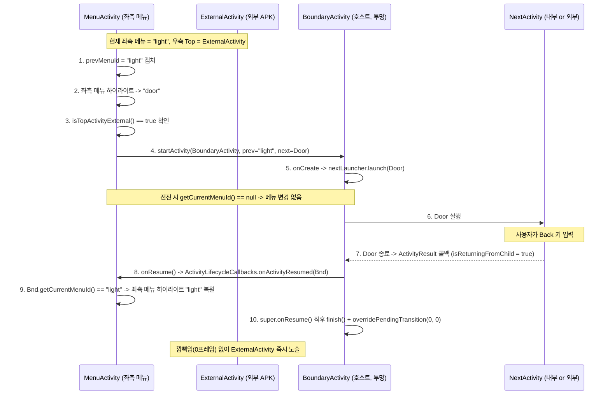

# Split UI에서 외부 APK 액티비티를 포함한 Back Stack 유지 및 메뉴 동기화 아키텍처 가이드

> **목적**: 좌측 메뉴(Primary Pane) + 우측 콘텐츠(Secondary Pane) 구조(Activity Embedding / Split UI)에서 카테고리 전환 시 기존 화면을 지우지 않고 **Back Stack을 유지**하면서도, **내부(동일 프로세스) 액티비티와 외부 APK(타 프로세스) 액티비티가 혼재된 환경**에서 Back 복귀 시 좌측 메뉴 하이라이트를 정확하게 동기화하는 범용 아키텍처 패턴을 정리합니다.

---

## 1. 문제 정의

### 1.1 요구사항
1. 좌측 메뉴에서 카테고리를 전환할 때 `FLAG_ACTIVITY_CLEAR_TOP` 등으로 이전 화면을 제거하지 않고, **Task Back Stack에 그대로 쌓는다**.
2. 사용자가 Back 키를 누르면 방문했던 카테고리(및 각 카테고리의 SubActivity)를 **역순으로 정확히 복원**한다.
3. Back 복귀 시 **좌측 메뉴의 선택(하이라이트) 상태**가 현재 우측에 표시된 콘텐츠의 카테고리와 항상 일치해야 한다.
4. 우측 콘텐츠에는 **호스트 앱 내부 액티비티**뿐 아니라 **외부 APK(별도 프로세스)의 카테고리 액티비티** 및 **내부 카테고리가 띄운 외부 SubActivity**도 포함될 수 있다.

### 1.2 왜 단순 구현으로는 해결되지 않는가?
- 내부 액티비티끼리의 전환/복귀는 호스트 프로세스 안에서 `Application.ActivityLifecycleCallbacks.onActivityResumed()`로 쉽게 감지할 수 있다.
- 그러나 **외부 APK 액티비티는 다른 프로세스에서 실행**되므로, Back 키로 외부 액티비티가 다시 최상단(Resumed)에 올라와도 **호스트 프로세스에는 어떠한 Lifecycle 콜백도 전달되지 않는다**.

```text
Task Back Stack 예시:
[Menu(Left)] | [Home(내부)] -> [Light(외부 APK)] -> [Door(내부)]
                                                       ▲
                              Back 키로 Door가 종료되면 Light(외부)가 드러나지만
                              호스트 앱은 Light.onResume()을 알 수 없음!
```

---

## 2. 핵심 아키텍처 원리

이 문제는 다음 **3가지 원리**의 조합으로 전역 상태 관리나 복잡한 스택 추적 없이 깔끔하게 해결할 수 있다.

### 원리 1. 공통 마커 인터페이스 + `BaseMenuContentActivity` 추상화
- 호스트 앱 내 모든 콘텐츠 액티비티(내부 메인 카테고리, 내부 SubActivity, 그리고 후술할 `BoundaryActivity`까지)가 동일한 인터페이스와 부모 클래스를 공유한다.
- 좌측 메뉴 액티비티(`MenuActivity`)는 `Application.ActivityLifecycleCallbacks`를 직접 등록하고, `onActivityResumed()` 단 한 곳에서 메뉴를 동기화한다.

```kotlin
interface MenuIdentifiable {
    /**
     * 현재 액티비티가 Resume 되었을 때 좌측 메뉴에 반영할 카테고리 ID.
     * null을 반환하면 메뉴 선택을 변경하지 않는다.
     */
    fun getCurrentMenuId(): String?
}

abstract class BaseMenuContentActivity : AppCompatActivity(), MenuIdentifiable
```

- **내부 카테고리 / 내부 SubActivity**: 자신이 속한 카테고리 ID를 반환.
- **`BoundaryActivity`**:
  - 전진(최초 실행) 시: `null` 반환 (곧 뜰 다음 카테고리의 메뉴 선택을 덮어쓰지 않음).
  - 복귀(자식 액티비티 종료 후 돌아옴) 시: 자신이 기억하고 있던 직전 외부 카테고리의 ID를 반환.

### 원리 2. `ActivityManager.getAppTasks()` 기반 외부 Top 액티비티 감지
새 카테고리를 실행하기 직전에, 호스트 앱이 스스로 "직전이 외부였는지" 플래그를 들고 있을 필요 없이 **OS(`ActivityManager`)에 현재 Task의 최상단 액티비티 패키지를 직접 질의**한다.

```kotlin
private fun isTopActivityExternal(): Boolean {
    val am = getSystemService(Context.ACTIVITY_SERVICE) as? ActivityManager ?: return false
    val currentTask = am.appTasks.firstOrNull { appTask ->
        try {
            val info = appTask.taskInfo
            val appTaskId = if (Build.VERSION.SDK_INT >= Build.VERSION_CODES.Q) info.taskId else @Suppress("DEPRECATION") info.id
            appTaskId == taskId
        } catch (_: Exception) {
            false
        }
    } ?: return false

    val topComponent = currentTask.taskInfo.topActivity ?: return false
    return topComponent.packageName != packageName
}
```

이 방식의 결정적 장점:
1. 직전 화면이 **외부 카테고리**이든, **내부 카테고리에서 띄운 외부 SubActivity**이든 동일한 조건(`topActivity.packageName != packageName`)으로 일관되게 판별한다.
2. 별도 상태 플래그를 관리하거나 `onSaveInstanceState`로 보존할 필요가 없어 Process Death 이후에도 100% 정확하다.

### 원리 3. 투명 경계 액티비티(`BoundaryActivity`) 삽입
`isTopActivityExternal() == true`일 때만, 호스트 소유의 투명 액티비티인 `BoundaryActivity`를 외부 액티비티 바로 위에 끼워 넣고 `BoundaryActivity`가 다음 카테고리(`nextIntent`)를 `ActivityResult`로 실행한다.



#### `BoundaryActivity`가 삽입되는 정확한 3가지 케이스
| 전환 시나리오 | `topActivity` 패키지 | `BoundaryActivity` 삽입 여부 | Back 복귀 시 메뉴 동기화 주체 |
|---|---|---|---|
| 내부 카테고리 → 내부/외부 카테고리 | 호스트 패키지 | **미삽입** | 내부 카테고리의 `onResume` |
| 내부 카테고리의 내부 Sub → 내부/외부 카테고리 | 호스트 패키지 | **미삽입** | 내부 Sub의 `onResume` |
| **내부 카테고리의 외부 Sub → 다른 카테고리** | **외부 패키지** | **삽입 (`prev = 내부 카테고리 ID`)** | **`BoundaryActivity`의 `onResume`** |
| **외부 카테고리 → 내부 카테고리** | **외부 패키지** | **삽입 (`prev = 외부 카테고리 ID`)** | **`BoundaryActivity`의 `onResume`** |
| **외부 카테고리 → 외부 카테고리** | **외부 패키지** | **삽입 (`prev = 외부 카테고리 ID`)** | **`BoundaryActivity`의 `onResume`** |

---

## 3. 핵심 설계 의사결정 (Trade-offs)

다른 프로젝트에 적용할 때 자주 검토하게 되는 대안들과 현재 설계를 선택한 이유입니다.

### Q1. 왜 `onDestroy` 감지가 아니라 `onResume` 감지 + `BoundaryActivity`인가?
- Android에서 이전 액티비티의 `onDestroy()`는 **비결정적 시점**에 호출된다(새 액티비티가 `onResume()`된 뒤 한참 지나서 호출되거나, 빠른 전환 시 순서가 뒤바뀔 수 있음).
- 또한 `외부 A → 외부 B` 전환에서는 `외부 B`가 종료될 때도 호스트에 `onDestroy`가 오지 않으므로 어차피 `BoundaryActivity`가 필요하다.
- `onResume()`은 현재 화면에 드러나는 시점과 정확히 일치하므로 타이밍 이슈가 없다.

### Q2. `BoundaryActivity`는 왜 `onActivityResult`가 아니라 `onResume()`에서 `finish()`하는가?
- `onActivityResult` 콜백 안에서 바로 `finish()`를 호출하면, Android 버전/OEM 최적화에 따라 이미 종료 표시(`mFinished == true`)된 액티비티의 `onResume()` 진입이 생략될 여지가 있다. 이 경우 `MenuActivity`의 `onActivityResumed` 콜백이 누락된다.
- 반대로 `onActivityResult`에서는 `isReturningFromChild = true`만 설정하고, `onResume()`의 `super.onResume()` 직후에 `finish()`를 호출하면:
  1. `Application.ActivityLifecycleCallbacks.onActivityResumed()` 전달이 **항상 보장**된다.
  2. `ActivityThread.handleResumeActivity()`는 `performResumeActivity()`(`deliverResults()` + `onResume()`)가 끝난 **뒤**에 `r.activity.mFinished`를 확인해 `WindowManager.addView()` 실행 여부를 결정하므로, **화면에 단 한 프레임도 그려지지 않고(깜빡임 0)** 즉시 종료된다.

### Q3. 왜 전역 싱글톤 Tracker 대신 `MenuActivity`가 `ActivityLifecycleCallbacks`를 직접 등록하는가?
- 전역 싱글톤(`CategoryMenuTracker` 등)을 두면 `Application` → `Tracker` → `MenuActivity`의 불필요한 중계 계층과 상태 동기화 버그 가능성이 생긴다.
- `MenuActivity`가 자신의 생명주기(`onCreate` ~ `onDestroy`) 동안 `application.registerActivityLifecycleCallbacks(...)`를 직접 구독/해제하면 코드가 대폭 단순해지고 메모리 누수도 없다.

---

## 4. 다른 프로젝트 적용용 구현 블루프린트

### 4.1 `BoundaryActivity` 구현
```kotlin
class BoundaryActivity : BaseMenuContentActivity() {

    companion object {
        const val EXTRA_BOUNDARY_MENU_ID = "extra_boundary_menu_id"
        const val EXTRA_NEXT_TARGET_INTENT = "extra_next_target_intent"
        private const val KEY_HAS_LAUNCHED_NEXT = "key_has_launched_next"
    }

    private var boundaryMenuId: String = ""
    private var hasLaunchedNext: Boolean = false
    private var isReturningFromChild: Boolean = false

    private val nextLauncher = registerForActivityResult(
        ActivityResultContracts.StartActivityForResult()
    ) {
        isReturningFromChild = true
    }

    override fun getCurrentMenuId(): String? =
        if (isReturningFromChild && boundaryMenuId.isNotEmpty()) boundaryMenuId else null

    override fun onCreate(savedInstanceState: Bundle?) {
        super.onCreate(savedInstanceState)
        overridePendingTransition(0, 0)
        // 주의: setContentView()를 호출하지 않는다 (불필요한 View inflation 방지)

        boundaryMenuId = intent?.getStringExtra(EXTRA_BOUNDARY_MENU_ID).orEmpty()
        hasLaunchedNext = savedInstanceState?.getBoolean(KEY_HAS_LAUNCHED_NEXT, false) ?: false

        if (!hasLaunchedNext) {
            val nextIntent: Intent? = if (Build.VERSION.SDK_INT >= Build.VERSION_CODES.TIRAMISU) {
                intent?.getParcelableExtra(EXTRA_NEXT_TARGET_INTENT, Intent::class.java)
            } else {
                @Suppress("DEPRECATION")
                intent?.getParcelableExtra(EXTRA_NEXT_TARGET_INTENT)
            }

            if (nextIntent != null) {
                hasLaunchedNext = true
                try {
                    nextLauncher.launch(nextIntent)
                    overridePendingTransition(0, 0)
                } catch (e: Exception) {
                    isReturningFromChild = true
                }
            } else {
                finish()
            }
        }
    }

    override fun onResume() {
        super.onResume()
        if (isReturningFromChild) {
            finish()
            overridePendingTransition(0, 0)
        }
    }

    override fun onSaveInstanceState(outState: Bundle) {
        super.onSaveInstanceState(outState)
        outState.putBoolean(KEY_HAS_LAUNCHED_NEXT, hasLaunchedNext)
    }
}
```

### 4.2 `AndroidManifest.xml` 설정
```xml
<!-- 투명 + 애니메이션 제거 테마 적용 -->
<activity
    android:name=".BoundaryActivity"
    android:exported="false"
    android:theme="@style/Theme.App.TranslucentNoAnim" />

<!-- 내부 카테고리 액티비티는 반드시 launchMode="standard" 사용 -->
<activity
    android:name=".CategorySettingsActivity"
    android:launchMode="standard" />
```

```xml
<!-- styles.xml -->
<style name="Theme.App.TranslucentNoAnim" parent="Theme.AppCompat.DayNight.NoActionBar">
    <item name="android:windowIsTranslucent">true</item>
    <item name="android:windowBackground">@android:color/transparent</item>
    <item name="android:windowContentOverlay">@null</item>
    <item name="android:windowNoTitle">true</item>
    <item name="android:backgroundDimEnabled">false</item>
    <item name="android:windowAnimationStyle">@null</item>
</style>
```

### 4.3 `MenuActivity` (좌측 메뉴) 핵심 로직
```kotlin
class MenuActivity : AppCompatActivity() {

    private var currentSelectedMenuId: String? = null

    private val contentLifecycleCallback = object : Application.ActivityLifecycleCallbacks {
        override fun onActivityResumed(activity: Activity) {
            val menuId = (activity as? MenuIdentifiable)?.getCurrentMenuId() ?: return
            selectMenuInUi(menuId)
        }
        // 나머지 콜백은 빈 구현
        override fun onActivityCreated(a: Activity, b: Bundle?) {}
        override fun onActivityStarted(a: Activity) {}
        override fun onActivityPaused(a: Activity) {}
        override fun onActivityStopped(a: Activity) {}
        override fun onActivitySaveInstanceState(a: Activity, b: Bundle) {}
        override fun onActivityDestroyed(a: Activity) {}
    }

    override fun onCreate(savedInstanceState: Bundle?) {
        super.onCreate(savedInstanceState)
        application.registerActivityLifecycleCallbacks(contentLifecycleCallback)
        savedInstanceState?.getString(KEY_ACTIVE_MENU_ID)?.let(::selectMenuInUi)
    }

    override fun onDestroy() {
        application.unregisterActivityLifecycleCallbacks(contentLifecycleCallback)
        super.onDestroy()
    }

    override fun onSaveInstanceState(outState: Bundle) {
        super.onSaveInstanceState(outState)
        currentSelectedMenuId?.let { outState.putString(KEY_ACTIVE_MENU_ID, it) }
    }

    fun onMenuItemClicked(targetMenuId: String, targetIntent: Intent) {
        // [중요 1] 선택 상태를 변경하기 전에 직전 메뉴 ID를 먼저 캡처!
        val prevMenuId = currentSelectedMenuId

        // [중요 2] 동일 카테고리 연속 클릭 시 중복 스택 푸시 방지
        if (targetMenuId == prevMenuId) return

        selectMenuInUi(targetMenuId)
        dispatchCategoryIntent(targetIntent, previousMenuId = prevMenuId)
    }

    private fun dispatchCategoryIntent(targetIntent: Intent, previousMenuId: String?) {
        val boundaryMenuId = previousMenuId.orEmpty()
        if (isTopActivityExternal() && boundaryMenuId.isNotEmpty()) {
            val boundaryIntent = Intent(this, BoundaryActivity::class.java).apply {
                putExtra(BoundaryActivity.EXTRA_BOUNDARY_MENU_ID, boundaryMenuId)
                putExtra(BoundaryActivity.EXTRA_NEXT_TARGET_INTENT, targetIntent)
            }
            startActivity(boundaryIntent)
            overridePendingTransition(0, 0)
        } else {
            startActivity(targetIntent)
            overridePendingTransition(0, 0)
        }
    }
}
```

---

## 5. 적용 시 주의할 함정 (Checklist & Pitfalls)

1. **`prevMenuId` 캡처 순서**
   - 메뉴 클릭 / 딥링크 처리 시 반드시 어댑터의 `selectedPosition`을 갱신하기 **전에** `prevMenuId = currentSelectedMenuId`를 캡처해야 한다. 순서가 뒤바뀌면 `BoundaryActivity`에 새 카테고리 ID가 들어가 Back 복귀 시 잘못된 메뉴가 선택된다.
2. **내부 카테고리 액티비티의 `launchMode`**
   - 여러 카테고리가 하나의 제네릭 액티비티 클래스를 공유한다면 `android:launchMode="standard"`여야 한다. `singleTop`이면 바로 직전 내부 카테고리에서 다른 내부 카테고리로 전환할 때 새 인스턴스가 쌓이지 않고 `onNewIntent`로 덮어쓰여 Back Stack이 깨진다.
3. **`BoundaryActivity`의 `hasLaunchedNext` 상태 저장**
   - `BoundaryActivity`가 백그라운드에 있는 상태에서 Configuration Change 또는 Process Death 후 복원될 때 `onCreate()`가 재호출된다. `hasLaunchedNext`를 `onSaveInstanceState`에 저장하지 않으면 `nextLauncher.launch(nextIntent)`가 중복 호출되어 스택이 꼬인다.
4. **Root 화면 vs Stacked 화면의 Back 처리 구분**
   - 예: 초기 진입 화면인 `Home`을 스택 중간에 다시 띄울 수 있는 경우, 최초 루트 `Home`(`EXTRA_IS_ROOT_HOME = true`)에서 Back을 누르면 앱 종료(`finishAffinity()`), 스택 위에 쌓인 `Home`(`EXTRA_IS_ROOT_HOME = false`)에서 Back을 누르면 일반 `finish()`로 이전 카테고리로 돌아가도록 구분해야 한다.
5. **메뉴가 아닌 곳(예: Home 내부 검색/바로가기)에서 외부 카테고리 실행 시**
   - 호출자가 이미 내부 액티비티이므로 `BoundaryActivity`는 불필요하지만, 외부 액티비티는 `onActivityResumed`를 발생시키지 않으므로 실행 시점에 좌측 메뉴에 선택 변경을 알려주는 훅(콜백/브릿지)이 필요하다.
6. **Split Rule(Activity Embedding) 설정**
   - `BoundaryActivity`와 모든 콘텐츠 액티비티가 Secondary Pane에 배치되도록 `SplitPairRule`에 포함되어야 하며, `BoundaryActivity`가 Secondary Pane에서 실행될 때 Primary Pane(`MenuActivity`)이 닫히지 않도록 `finishPrimaryWithSecondary = NEVER` 등으로 설정한다.

---

## 6. 본 프로젝트 레퍼런스 구현

실제 동작하는 전체 구현은 아래 파일들을 참고할 수 있습니다.
- [GetCurrentMenuId.kt](file:///c:/Users/user/Documents/antigravity/kind-curie/core-item-contract/src/main/java/com/example/core/item/GetCurrentMenuId.kt) — 마커 인터페이스
- [BaseMenuContentActivity.kt](file:///c:/Users/user/Documents/antigravity/kind-curie/common-ui-settings/src/main/java/com/example/common/ui/settings/BaseMenuContentActivity.kt) — 공통 부모 액티비티
- [BoundaryActivity.kt](file:///c:/Users/user/Documents/antigravity/kind-curie/app/src/main/java/com/example/lifecycleapp/BoundaryActivity.kt) — 투명 경계 액티비티
- [ListActivity.kt](file:///c:/Users/user/Documents/antigravity/kind-curie/app/src/main/java/com/example/lifecycleapp/ListActivity.kt) — `ActivityLifecycleCallbacks` 직접 구독
- [BaseCategoryMenuActivity.kt](file:///c:/Users/user/Documents/antigravity/kind-curie/app/src/main/java/com/example/lifecycleapp/BaseCategoryMenuActivity.kt) — `isTopActivityExternal()` 및 `dispatchCategoryIntent()`
- [stacked_category_history_and_boundary_architecture.md](file:///c:/Users/user/Documents/antigravity/kind-curie/docs/stacked_category_history_and_boundary_architecture.md) — 본 프로젝트 상세 아키텍처 및 에뮬레이터 검증 기록
