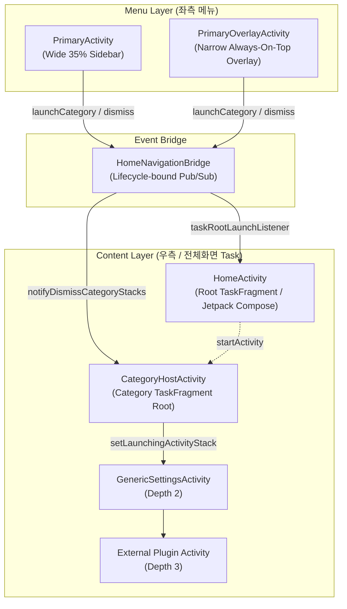

# Unified Split and Overlay Architecture (Wide & Narrow Modes)

본 문서는 Jetpack WindowManager의 Activity Embedding과 Overlay Window를 기반으로 구현된 **Wide Mode (분할 화면)** 및 **Narrow Mode (오버레이 서랍 화면)** 의 통합 구조와 수명주기/스택 관리 메커니즘을 설명합니다.

---

## 1. 개요 및 설계 목표

1. **단일 코드베이스로 두 가지 폼팩터 지원**:
   - **Wide Mode**: 태블릿/차량용 와이드 디스플레이에서 좌측 35% 네비게이션 메뉴(`PrimaryActivity`), 우측 65% 콘텐츠 컨테이너(`HomeActivity` 및 서브 설정 화면)의 `SplitPairRule` 2열 분할 레이아웃.
   - **Narrow Mode**: 화면 폭이 좁은 디스플레이에서 전체 화면 콘텐츠 컨테이너(`HomeActivity` 및 서브 설정 화면) 위에 항상 최상단(Always-On-Top)으로 상주하는 핀형 플로팅 오버레이 메뉴(`PrimaryOverlayActivity`, 80dp 원형 버튼 ↔ 35% 좌측 서랍 패널).
2. **원자적 스택 정리 (Atomic ActivityStack Cleanup)**:
   - 카테고리 전환 시 이전 카테고리의 모든 하위 뎁스(Depth >= 2, 내부/외부 액티비티)를 `finishActivityStacks()`를 통해 OS 레벨에서 완벽히 일괄 정리.
3. **수명주기 안전성 (Pub/Sub Event Bridge)**:
   - 정적(`companion object`) 액티비티 인스턴스나 `WeakReference` 저장 방식을 완전히 배제하고, `onCreate` 구독 및 `onDestroy` 해제 기반의 이벤트 브릿지([HomeNavigationBridge](file:///C:/Users/user/.gemini/antigravity/worktrees/kind-curie/say_hello/feature-home/src/main/java/com/example/feature/home/HomeNavigationBridge.kt))를 통해 메모리 누수 및 수명주기 교차 문제를 원천 차단.

---

## 2. 모드별 아키텍처 비교

| 항목 | Wide Mode (태블릿 / 차량 가로 화면) | Narrow Mode (스마트폰 / 좁은 세로 화면) |
| :--- | :--- | :--- |
| **WindowManager Rule** | `SplitPairRule` (35% : 65%) | `ActivityRule(alwaysExpand = true)` + Pinned Overlay |
| **진입점 (MainActivity)** | `PrimaryActivity` (좌측 35% 메뉴 고정) | `PrimaryActivity` → `HomeActivity` 부트스트랩 후 종료 |
| **메뉴 액티비티** | `PrimaryActivity` (일반 액티비티) | `PrimaryOverlayActivity` (Always-On-Top Translucent Overlay) |
| **메뉴 형태** | 항상 노출되는 좌측 35% 고정 사이드바 | 80dp 원형 플로팅 버튼(☰ MENU) ↔ 35% 좌측 슬라이딩 서랍 |
| **루트 콘텐츠 화면** | `HomeActivity` (우측 65% 컨테이너 #1) | `HomeActivity` (전체 화면 TaskFragment #0) |
| **카테고리 컨테이너** | `CategoryHostActivity` (우측 65% 컨테이너 #2) | `CategoryHostActivity` (전체 화면 TaskFragment #1) |
| **하위 설정 화면** | `CategoryHostActivity` 스택 내 누적 (Depth >= 2) | `CategoryHostActivity` 스택 내 누적 (Depth >= 2) |

---

## 3. 핵심 컴포넌트 및 역할

### 1) [HomeNavigationBridge.kt](file:///C:/Users/user/.gemini/antigravity/worktrees/kind-curie/say_hello/feature-home/src/main/java/com/example/feature/home/HomeNavigationBridge.kt)
- **역할**: `Primary` 메뉴, `HomeActivity`, `CategoryHostActivity` 간의 비동기 이벤트 중계.
- **수명주기 리스너 구독**:
  - `registerCategoryHostDismissListener()`: `CategoryHostActivity.onCreate()` 시 등록, `onDestroy()` 시 해제.
  - `registerTaskRootLaunchListener()`: `HomeActivity.onCreate()` 시 등록, `onDestroy()` 시 해제.
- **주요 함수**:
  - `launchCategory(caller, targetIntent)`: 활성 카테고리 스택 정리 후 새로운 카테고리 스택 기동.
  - `notifyDismissCategoryStacks()`: 현재 등록된 모든 `CategoryHostActivity` 인스턴스에 스택 종료 명령 전달.

### 2) [CategoryHostActivity.kt](file:///C:/Users/user/.gemini/antigravity/worktrees/kind-curie/say_hello/feature-home/src/main/java/com/example/feature/home/CategoryHostActivity.kt)
- **역할**: 카테고리 TaskFragment의 루트(`Hist #0`) 역할을 담당하는 초경량 투명 액티비티.
- **동작 원리**:
  1. `onCreate` 시 dismiss 리스너를 등록하고, 전달받은 `targetIntent`를 `setLaunchingActivityStack` 옵션과 함께 실행하여 자신의 스택 내부로 격리 실행.
  2. dismiss 통지를 받으면 `ActivityEmbeddingController.getInstance(this).getActivityStack(this)`를 조회하여 `finishActivityStacks(setOf(stack))`를 호출. 해당 스택의 모든 하위 액티비티(Depth >= 2)가 원자적으로 즉시 종료됨.
  3. 모든 하위 액티비티가 사용자의 Back 키 입력으로 종료되어 다시 `CategoryHostActivity`로 돌아오면(`onResume`), 스스로 `finish()`하여 아래에 깔린 `HomeActivity`를 자연스럽게 노출.

### 3) [PrimaryOverlayActivity.kt](file:///C:/Users/user/.gemini/antigravity/worktrees/kind-curie/say_hello/app/src/main/java/com/example/lifecycleapp/PrimaryOverlayActivity.kt) (Narrow Mode)
- **역할**: Narrow Mode에서 항상 화면 최상단에 떠 있는 플로팅 메뉴 오버레이.
- **윈도우 바운즈 동적 리사이징의 목적 (터치 이벤트 보장)**:
  - 안드로이드의 `Activity` 윈도우는 배경이 100% 투명하더라도, **자신의 Window Bounds 사각형 영역 전체로 들어오는 모든 터치 입력을 기본적으로 가로챕니다(Consume).**
  - 만약 접힌 상태에서도 윈도우 크기를 35%로 유지하면, 비어있는 투명 영역 아래에 있는 `HomeActivity`나 콘텐츠 화면의 터치가 모두 먹통이 되는 **'터치 블랙홀' 현상**이 발생합니다.
  - 따라서 접혔을 때는 `OverlayController.updateOverlayAttributes()`를 통해 **윈도우 자체의 물리적 크기를 정확히 `80dp × 80dp` 사각형으로 축소**하여, 버튼 바깥의 모든 화면 영역 터치를 아래 레이어로 100% 온전히 통과시킵니다.
  - 서랍이 열릴 때만 윈도우 크기를 `가로 35% × 세로 100%`로 확장하여 카테고리 목록의 스크롤 및 터치를 수신합니다.
- **80dp 고정 뷰 크기 설계 (형상 왜곡 방지)**:
  - 서랍을 열 때 윈도우 바운즈가 `80dp × 80dp`에서 `35% × 100%`로 즉시 확장되는데, 만약 버튼 뷰(`layoutCollapsed`)가 `match_parent`이면 애니메이션 도중 윈도우 크기에 맞춰 늘어나면서 **원형 버튼이 거대한 타원형 기둥으로 일시 확대되는 왜곡 현상**이 발생합니다.
  - 이를 방지하기 위해 XML 레이아웃에서 `layoutCollapsed`의 크기를 **`80dp × 80dp` 고정 크기**(`layout_gravity="center_vertical|start"`)로 잠금 처리하여, 윈도우가 확장되어도 버튼이 제자리에서 본래 크기를 유지한 채 매끄럽게 축소(`scale 1.0 -> 0.7`) 및 fade-out 되도록 설계했습니다.
- **애니메이션 및 뷰 전환**:
  - **80dp 고정 원형 버튼 (☰ MENU)**: 화면 좌측 중앙에 위치. 윈도우 확장 시 `scale (1.0 -> 0.7)` 축소 & `fade-out`.
  - **35% 좌측 슬라이딩 서랍 (Drawer)**: 화면 왼쪽 바깥에서 `slide-in-left` & `fade-in`으로 부드럽게 등장.
  - **접기 / 카테고리 선택 / Back 키**: 35% 서랍이 왼쪽으로 `slide-out` & `fade-out` 되며, 원형 버튼이 `scale (0.6 -> 1.0)`로 탄성(`OvershootInterpolator`) 팝업 복귀.

### 4) [SplitInitializer.kt](file:///C:/Users/user/.gemini/antigravity/worktrees/kind-curie/say_hello/app/src/main/java/com/example/lifecycleapp/SplitInitializer.kt)
- **앱 시작 시 모드별 규칙 구성**:
  - **Narrow**: `ActivityRule(HomeActivity, CategoryHostActivity, alwaysExpand = true)` 등록.
  - **Wide**: `SplitPairRule(PrimaryActivity <-> HomeActivity, ratio = 0.35)` 및 `SplitPairRule(PrimaryActivity <-> CategoryHostActivity, ratio = 0.35)` 등록.

---

## 4. 내비게이션 시나리오별 동작 흐름

### 시나리오 A: 카테고리 전환 (Category A → Category B)
1. 사용자가 좌측 메뉴에서 Category B 클릭.
2. `BaseCategoryMenuActivity` → `HomeNavigationBridge.launchCategory(this, intentB)` 호출.
3. `HomeNavigationBridge.notifyDismissCategoryStacks()` 실행:
   - 기존 Category A의 `CategoryHostActivity`가 `finishActivityStacks()`를 실행하여 Category A 및 모든 하위 화면 일괄 종료.
4. 새로운 `CategoryHostActivity`가 기동되어 Category B 화면을 새 스택으로 띄움.
5. 이전 화면들의 잔여 스택이나 메모리 누수 없이 100% 원자적 전환 완료.

### 시나리오 B: Home 복귀
1. 사용자가 메뉴에서 `Home` 클릭:
   - `HomeNavigationBridge.notifyDismissCategoryStacks()` 호출.
   - 열려있던 카테고리 스택이 즉시 닫히며, 이미 밑에 준비되어 있던 `HomeActivity`가 화면에 나타남. (Home을 새로 시작하거나 재생성하지 않아 깜빡임 없음)
2. 사용자가 카테고리 서브 화면에서 `Back` 키 연타:
   - 하위 화면들이 차례로 pop되고 마지막에 `CategoryHostActivity`가 resume되어 스스로 종료됨.
   - 자연스럽게 `HomeActivity`로 복귀.

---

## 5. 결론 및 장점

- **누수 없는 안전한 수명주기**: WeakReference, 정적 필드 없이 안전한 이벤트 기반 아키텍처 구축.
- **완벽한 스택 청소**: WindowManager의 `finishActivityStacks` API를 활용하여 써드파티/외부 액티비티 뎁스까지 완벽 정리.
- **모드 간 코드 재사용성 극대화**: 카테고리 메뉴 탐색 및 실행 로직이 Wide/Narrow 분기 없이 단일 브릿지로 통합.
- **세련된 UX**: Narrow 모드에서 크기 왜곡 없는 80dp 원형 버튼과 35% 서랍 간의 부드러운 하드웨어 가속 슬라이드/페이드 애니메이션 제공.
